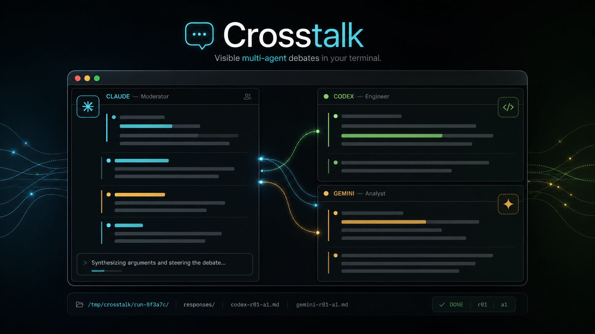
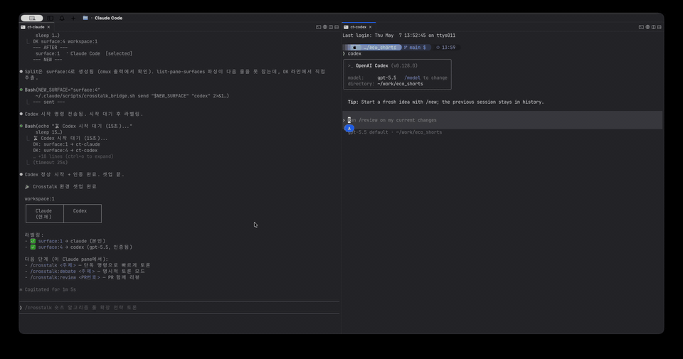

# Crosstalk

English | [한국어](README.ko.md)

[](LICENSE)


Discuss a topic with Claude and Codex side by side in Ghostty, or invite Antigravity (`agy`) as a peer. Ask from either CLI. Crosstalk reuses the other AI's pane or opens a native split, sends the question, and returns the response. No tmux required.



> v0.12.1 adds captured-input independent review for a Claude caller and fresh Codex peer. Natural independent-review requests select that route without an engine option. General engine discussions remain opt-in; existing mailbox-v2 threads keep their meaning. Read the [independent-review boundary](docs/independent-review.md), [upgrade guide](docs/upgrade-v0.12.md) and [v0.12 verification record](docs/verification-v0.12.md). Full release/live verification is not implied.

## Overview

Crosstalk connects existing interactive AI CLIs. Start from Codex with `$crosstalk <topic>` or Claude Code with `/crosstalk <topic>`. The caller compares the participants’ answers without forcing agreement. For protected first-input handling, use the independent-review request described below; ordinary mailbox conversations do not acquire that guarantee retroactively.

**Ghostty is the main getting-started path for Claude ↔ Codex discussion.** The existing cmux backend remains available for advanced workflows. Support differs by backend:

| Capability | Ghostty on macOS | cmux |
| --- | --- | --- |
| Claude ↔ Codex ordinary mailbox | mailbox-v2 compatibility retained | Legacy supported; Codex caller experimental |
| Discussion engine 1 (`--engine`) | One caller/one peer, explicit opt-in; v0.12 live checks pending | Unsupported; keep RUN_ID workflows |
| Natural independent review | Claude caller → fresh Codex peer; captured user statements, no `--engine` needed | Unsupported |
| Quick opinions (`ask`) | Supported | Supported |
| Prepare peer panes | Native split or reuse in the same tab | Workspace splits through `:launch` |
| Antigravity (`agy`) peer | Ordinary compatibility; engine peer readiness requires protocol 3/engine 1 and live verification | Legacy supported |
| Co-work and PR review | Not yet ported | Available; deep review experimental |
| Screen capture / screen transport | Unsupported by this adapter; not required by the engine | Legacy available |

See the [Ghostty verification record](docs/ghostty-verification.md) for the actual checks and their limits. This checkout includes the Ghostty integration. Update older marketplace installations before following the quick start.

## Independent review from normal conversation (v0.12.1)

Keep discussing the task with Claude, then say:

> Review this independently with Codex.

Crosstalk uses the recorded user question and subsequent user constraints, not a first message rewritten by Claude. When the subject is clear, it proceeds; only missing scope or unverified provenance needs one focused clarification. Claude keeps its context, and a new Codex conversation is launched beside the existing pane for the captured input. Existing Codex panes are not cleared or closed. Both first answers are stored before they are exchanged; subsequent rounds can discuss and revise positions normally.

This route requires the updated Claude plugin capture hook and runtime. Reload the plugin/session after installation. The first independent task cannot override its body, rules or persona. A request to critique Claude’s proposal instead uses the explicitly labeled proposal-review mode; an existing-context opinion is not presented as independent review. Project instructions and shared files are still visible, so a new conversation is not a promise of a completely blank or unbiased model. See [details and limits](docs/independent-review.md).

## General opt-in discussion engine (v0.12)

The engine stores the current run, round, action, fixed input and termination reason. AI performs analysis/comparison; code owns progression and atomic state changes. Start explicitly while live release gates are pending:

```text
# Claude
/crosstalk:analyze --engine <topic>
/crosstalk:ask --engine <question>
# Codex
$crosstalk analyze --engine <topic>
$crosstalk ask --engine <question>
```

Both participants need verified protocol-3/engine-1 readiness. `capabilities --json` returns `discussion_instructions`; its [canonical workflow](assets/codex-skills/crosstalk/discussion.md) uses `run start`, `next`, `take`, `submit`, `decide`, `status`, `report` and explicit recovery controls. `run start` itself is the low-level opt-in; `engine_default=false` keeps other new requests on ordinary mailbox behavior; natural independent-review intent has its own protected route. Existing threads/runs never change execution owner silently.

The caller must save its first analysis before Crosstalk APIs expose the peer's first answer. This is disclosure order, not isolation from a neighboring pane or proof against shared-context bias. Later decisions cite the fixed current results; a peer's agreement alone does not prove consensus. Final results distinguish the caller's conclusion, retained disagreement, insufficient information and round-limit termination.

Ask stores each participant's answer and ends as sampled: no compare action, extra round, caller reply wake-up or pretend read acknowledgement. `run report` shows saved results on request. `run continue` releases workflow pause/local handoff; `recover` reclaims an authorized message lease; `retry` only resubmits a notification.

No daemon, direct model API, model/effort override, agy caller, mixed-terminal run, multi-peer quorum or Ghostty cowork/review port is added. See [engine contract](docs/discussion-engine-v1.md), [adapters](docs/adapter-contracts.md), [upgrade](docs/upgrade-v0.12.md) and [current verification](docs/verification-v0.12.md). Startup text remains short; detailed handshake instructions live in a private temporary file.

## Features

- **Visible discussion**: watch Claude and Codex work in neighboring Ghostty panes, starting from either CLI.
- **Reuse existing CLI accounts**: Crosstalk does not introduce a separate model API integration.
- **Automatic peer preparation**: launch the other CLI in the current directory when no labelled peer exists in the tab; wait for its startup acknowledgement before sending a task.
- **Protected independent first input**: in the Claude-capture workflow, the peer receives recorded user statements and neutral instructions rather than the caller’s rewritten conclusion.
- **Durable mailbox**: Ghostty requests and replies are stored in SQLite. `send`, `receive`, and `reply` handle IDs, receipt state, and reply notifications; AIs no longer manage per-message MD files or ping commands.
- **Explicit results**: ordinary replies retain verdict/confidence fields; opt-in engine actions add fixed input references and structured comparison decisions. Legacy cmux markers remain safely parsed as JSON.
- **Quick opinions**: `ask` lets each AI answer in its own pane without callbacks or aggregation.
- **Advanced cmux workflows**: co-work in git worktrees, PR review, and Antigravity peers remain available through cmux.

## Requirements

| Tool | Needed for | Notes |
| --- | --- | --- |
| macOS | Both terminal backends | Use an OS version supported by your terminal app |
| Ghostty with required AppleScript operations | Native Claude ↔ Codex workflow | Exact addressing/input capabilities must be observed; tested versions are in verification |
| Claude Code or Codex CLI | Discussion caller | At least one is required to start a discussion |
| Claude, Codex, or Antigravity (`agy`) | Peer | Install and authenticate the caller and the peer you choose |
| jq | Bridge and configuration | Required |
| Python 3.11+ with sqlite3 | Ghostty mailbox | Standard library only; no pip packages or server |
| Node.js / npm | Installing npm-distributed AI CLIs | Not a separate Crosstalk runtime |
| cmux 1.3+ | Alternative backend and advanced workflows | Optional for Ghostty discussion |
| GitHub CLI (`gh`) | PR review | Optional |

Antigravity (`agy`) is a standalone download. It can participate as a peer in Ghostty mailbox discussions or legacy cmux runs. Install and authenticate the CLIs you plan to use.

## Language

Crosstalk supports English and Korean command UI. During `/crosstalk:install`, choose the interface language:

- English
- Korean

The setting is stored in:

```text
~/.claude/crosstalk/config.json
```

```json
{
  "active_rules": "default",
  "active_persona": "default",
  "language": "en"
}
```

Use `"language": "ko"` for Korean. Built-in rules and personas are installed in both languages:

```text
~/.claude/crosstalk/rules/{en,ko}/
~/.claude/crosstalk/personas/{en,ko}/
```

## Installation

In Claude Code:

```text
/plugin marketplace add dongsik93/crosstalk
/plugin install crosstalk@crosstalk
```

Then run the one-time setup:

```text
/crosstalk:install
```

This installs:

- `~/.claude/scripts/crosstalk` and a `~/.local/bin/crosstalk` symlink (if that name is free)
- `~/.claude/crosstalk/mailbox.md`
- `~/.claude/scripts/crosstalk_bridge.sh`
- `~/.claude/scripts/crosstalk_ghostty.sh`
- `~/.claude/commands/crosstalk.md`
- `~/.codex/skills/crosstalk/`
- built-in rules and personas under `~/.claude/crosstalk/`

## Quick Start — Ghostty

After installing the Ghostty-enabled version of Crosstalk, open your project in Ghostty and run either CLI normally. Existing sessions can stay open.

**Starting from Codex:**

```text
$crosstalk Should this project use Compose or XML? Discuss it with Claude.
```

**Starting from Claude Code:**

```text
/crosstalk Should this project use Compose or XML?
```

Claude and Codex are the default pair. To use Antigravity, name it explicitly:

```text
$crosstalk Review this design with agy.
/crosstalk Review this design with agy.
```

Crosstalk reuses a labelled peer in the same tab or creates a right split and starts the other CLI in the current directory. Finish any first-use login/trust prompts there. Once startup is acknowledged, the question is delivered and completion callbacks return to the caller.

```text
Ghostty tab
├── Codex  ← questions and responses →  Claude
```

For quick independent opinions, use `$crosstalk ask <question>` or `/crosstalk:ask <question>`. Each AI answers in its own pane; no combined result is produced.

To check status without launching a peer, run `$crosstalk` or `/crosstalk` without a topic. The readiness check shows the backend, caller, and peers. If the caller cannot be identified, report that error and preserve the topic for `$crosstalk resume` or `/crosstalk:resume`.

### Models and reasoning effort

Crosstalk does not currently set a model or effort level. Reused panes keep their session settings; newly launched CLIs use their own defaults. Codex settings are not copied to Claude, or vice versa. There is no Crosstalk-specific model/effort override yet.

### Permissions for new peer panes

When the Crosstalk skill or slash command needs to create a new Ghostty peer, it offers two choices:

| Choice | Behavior |
| --- | --- |
| Keep CLI settings (default) | Adds no permission-bypass flag; the CLI keeps its own settings |
| Auto-approve this launch | Adds the option below for this new peer only |

| Peer | Option added by `--auto-approve` |
| --- | --- |
| Codex | `--yolo` — bypasses approvals **and the sandbox** |
| Claude | `--dangerously-skip-permissions` |
| Antigravity (`agy`) | `--dangerously-skip-permissions`; still starts with `--prompt-interactive` |

Auto-approval applies to all tools in that session, not just mailbox commands. The choice is not saved globally. Existing peers keep their current permissions and are reused without another choice. Changing an existing peer's mode requires an explicit user decision to restart it; the bridge will not do so automatically.

Direct bridge commands do not display a choice. Without the flag, they keep CLI defaults:

```sh
~/.claude/scripts/crosstalk_bridge.sh ensure-peer codex agy
```

After explicitly choosing auto-approval for a **new** peer:

```sh
~/.claude/scripts/crosstalk_bridge.sh ensure-peer claude codex --auto-approve
~/.claude/scripts/crosstalk_bridge.sh ensure-peer codex claude --auto-approve
~/.claude/scripts/crosstalk_bridge.sh ensure-peer codex agy --auto-approve
```

An existing matching peer causes `--auto-approve` to be rejected. Omit the flag to reuse it; a timeout or permission prompt is not permission to relaunch with broader access.

## Ghostty setup and troubleshooting

### Antigravity (`agy`) peer

Ask Codex or Claude to discuss a topic with agy, or prepare and contact it directly:

```sh
~/.claude/scripts/crosstalk_bridge.sh ensure-peer codex agy
crosstalk send agy "Review this approach" --summary "Reviewing the proposed approach"
```

From Claude, use `ensure-peer claude agy`. `agy` and `antigravity` resolve to the same peer kind. The launcher uses `agy --prompt-interactive` and preserves the caller PATH. The common permission choice above applies to agy too. Finish any login, project, or tool-approval prompts in the new pane. On timeout, reuse the pending pane instead of launching another copy.

New agy panes complete protocol-3/engine-1 readiness at startup. Existing panes must reload instructions and explicitly handshake before new engine work. `receive` dispatches managed work to the canonical `discussion_instructions`; ordinary mailbox-v2 work uses `mailbox_instructions`. `/crosstalk-peer ... RUN_ID=...` remains the legacy handler. agy is peer-only in the new engine; callers are Claude or Codex. v0.12 live validation remains pending.

### Identification and recovery

Session bindings separate logical ownership from the physical pane. New engine work requires protocol 3 and engine 1 readiness; ordinary protocol-2 bindings do not imply that capability. Claude/agy can use an exact TTY probe; Codex's CLI session ID alone does not prove its pane address. `bridge strict-self` refuses labels/cwd as fallback. Use `/crosstalk:setup --surface ghostty:<UUID>` for a user-selected target and let each CLI execute its own one-use challenge/bind. `session status` confirms readiness; labelling alone does not.

Resuming a CLI in another pane requires explicit rebind to the intended logical session and a new binding generation. Old work does not transfer merely because the old pane closed. If the old pane is still alive or repository context changed, confirm the handoff. Read history and use authorized recover for interrupted claims. Do not guess focus, title, kind or cwd.

Codex must explicitly supply the exact current `CROSSTALK_SURFACE_ID` and shared `CROSSTALK_CONFIG_DIR` on every Ghostty protocol invocation. Its thread cache cannot prove its pane after resume, even while the previous pane is still alive. Reselect the current target and handshake after restart/resume; do not copy an old surface from conversation memory. See [readiness](assets/codex-skills/crosstalk/readiness.md) for current invocation and handshake forms.

On startup timeout reuse the pending pane and address its observed login/trust prompt; do not launch duplicates or bypass permission settings. Unknown panes may be labelled as candidates but still need a verified protocol/engine handshake. No Ghostty screen-capture/footer-readiness fallback exists. Cowork and review remain cmux-only.

Inspect exact candidate addresses with:

```sh
osascript -e 'tell application "Ghostty" to get {id, name, working directory} of every terminal'
crosstalk capabilities --json
crosstalk doctor --offline
crosstalk session status
```

Long bodies remain in SQLite. Notification submission is separate from receipt and completion. The automated suite uses isolated fake terminals; v0.12 engine acceptance is tracked separately in [verification](docs/verification-v0.12.md).

## Demo

The existing demo and hero image show the cmux workflow. They are not recordings of the new Ghostty integration.



## Commands

### Main (everyday use)

| Command | Description |
| --- | --- |
| `/crosstalk <topic>` | **Single entrypoint.** Runs analyze; inline-handles missing setup; prepares a Codex peer on Ghostty. |
| `/crosstalk` | Empty call → readiness doctor (installed / backend / peers + next single action). |
| `/crosstalk:analyze <topic>` | Explicit analyze. Independent multi-agent analysis with conditional ping-pong, ends in consensus or respectful divergence. |
| `/crosstalk:ask <question>` | **Lightweight opinion sampling (v0.7.0+).** Each peer answers once in its own pane. No debate, no ping-pong, no aggregation. |
| `/crosstalk:resume` | Resume a topic that was preserved when `/crosstalk` was unable to identify its caller terminal. |
| `/crosstalk:cowork "claude=A, codex=B, goal=Y"` | **cmux workflow.** Each peer runs its own `/goal` in its own CLI to deliver a piece of the task in parallel. Worktree-isolated by default. |
| `/crosstalk:cowork-stop [RUN_ID]` | **cmux workflow.** Stop an in-flight cowork run. Sends `/goal clear` + termination notice to every peer. |
| `/crosstalk:status` | Show active rules, personas, and pane status. |
| `/crosstalk:install` / `/crosstalk:uninstall` | Install or remove Crosstalk components. |

### Codex caller (experimental)

Run these from a Codex pane after `/crosstalk:install` has installed `~/.codex/skills/crosstalk/`.

| Command | Description |
| --- | --- |
| `$crosstalk <topic>` | Codex caller entrypoint. Runs analyze and uses Codex as the moderator. |
| `$crosstalk analyze [--rules <name>] [--persona <name>] <topic>` | Explicit analyze from Codex. |
| `$crosstalk ask <question>` | Lightweight opinion sampling from Codex (v0.7.0+). |
| `$crosstalk cowork "claude=A, antigravity=B, goal=Y"` | Start co-work mode from Codex (cmux workflow). |
| `$crosstalk cowork-stop [RUN_ID]` | Stop an in-flight cowork run from Codex (cmux workflow). |
| `$crosstalk resume` | Resume a preserved topic from Codex. |
| `$crosstalk status` | Show setup and pane status from Codex. |

### Advanced

These exist for manual control or recovery — you typically don't need them.

| Command | Description |
| --- | --- |
| `/crosstalk:analyze --rules <name> <topic>` | Apply a rules preset for one analyze run. |
| `/crosstalk:analyze --persona <name> <topic>` | Apply a persona preset for one analyze run. |
| `/crosstalk:launch` | Prepare the other CLI in Ghostty, or launch workspace peers in cmux. |
| `/crosstalk:setup` | Label already-open terminal panes (`--language en\|ko` also switches UI language). |
| `/crosstalk:rules` / `/crosstalk:persona` | Switch, create, edit, or delete presets. |
| `/crosstalk:review [PR]` | cmux workflow: moderator-driven PR review using `gh pr diff`. |
| `/crosstalk:review --deep [PR]` | cmux workflow: pinned detached worktree review with safe cleanup. |

## How It Works — ordinary mailbox-v2 compatibility

This section is for ordinary threads, not managed discussion-v1 messages. Complete caller and peer handshake through setup. `crosstalk capabilities --json` reports protocol/schema and the actual mailbox instruction path. Labels alone do not establish ownership. `send` selects a verified logical peer; if kind alone is ambiguous, select its `--peer-session` explicitly. `~/.claude/scripts/crosstalk` is the direct path if the executable is not on PATH.

```sh
crosstalk capabilities --json
crosstalk send claude "What do you think of this design?" --summary "Reviewing the design"
crosstalk receive
crosstalk reply <REQUEST_ID> "My analysis..." --lease-token <TOKEN> --verdict none --confidence unknown
```

Use `codex` when Claude is the caller. Long bodies use `--stdin`. Send saves before notifying; receive claims one queued message in insertion order and returns a private token. Reply saves one answer and completes its request atomically. The caller then receives the reply and persists its comparison with `ack <REPLY_ID> --lease-token <TOKEN> --outcome concluded --result-stdin`, or atomically creates the next round with `send <peer> --thread <THREAD_ID> --after-reply <REPLY_ID> --lease-token <TOKEN> --stdin`.

```text
request: queued -> processing -> completed (reply saved)
reply:   queued -> processing -> completed (ack or next request saved)
expired processing -> effective recovery_required -> explicit authorized reclaim
```

Body markers do not set v2 verdicts; `--verdict` and `--confidence` do. A peer's agreement is not proof of correctness. The thread limit remains ten requests. Ask saves replies without callback or automatic discussion; a requested later read is acknowledged as observed. Summaries remain display-only previews, never routing identity. Process the fetched body and one claim at a time.

### Recovery

| Command | Purpose |
| --- | --- |
| `doctor --offline` | Read installation/DB/recovery state without terminal input or repairs. |
| `status [ID]`, `history ID` | Inspect without claiming; use `--limit`/`--offset` for more rows. |
| `retry ID` | Resubmit the same saved notification, not the task. |
| `recover ID` | Diagnose an interrupted claim without changing it. |
| `recover ID --reclaim --expected-claim-version N --confirm-external-effects` | After user authorization, reclaim the same message with a fresh lease. |
| `renew ID --lease-token TOKEN` | Extend a valid claim; does not resurrect an expired one. |

`receive ID --replay` is deprecated. A saved message is not lost because its notification is failed/unknown. Check status and retry its ID rather than creating a replacement. Submitted input is not AI receipt. Read history and check external changes before recovery; the old process may still be running. Rebind invalidates old tokens. Exact duplicate reply submissions confirm the saved result rather than overwrite it.

There is no daemon, automatic reclaim or guarantee that external file/network actions run exactly once. DB and backups hold local plaintext conversation data with private permissions, not a security sandbox or encrypted storage. Both participants share `CROSSTALK_CONFIG_DIR`. See [protocol](docs/protocol-v2.md), [upgrade](docs/upgrade-v0.11.md), [recovery](docs/recovery.md), and [verification](docs/verification-v0.11.md).

### Legacy file protocol

cmux workflows and existing `RUN_ID` conversations continue using `/tmp/crosstalk/run-*` with `preambles/`, `rounds/`, `assignments/`, `responses/`, and completion `ping`. The old low-level `crosstalk_bridge.sh send <surface> <text>` remains available; it is separate from the new mailbox `crosstalk send <peer> <body>` command.

## Advanced workflows — cmux

Use cmux for co-work and PR review. These workflows have not yet been ported to Ghostty; Antigravity mailbox discussions are supported.

For PR review, run `/crosstalk:review <PR>`. Deep review uses an owned detached worktree at pinned base/head commits. Original checkout/index/stash are preserved; dirty or uncertain review worktrees are retained. See [review safety](docs/review-safety.md).

### Co-work

`analyze` is for *opinions*. `cowork` is for *delivery*. Give each peer an assignment and a goal. Each runs its own `/goal` slash command in its CLI and works until it considers the goal met.

```text
/crosstalk:cowork "claude=Repository layer, codex=ViewModel layer, goal=mail search feature shipping with passing tests"
```

Flow:

1. **Crosstalk parses the assignment**, asks once whether to isolate work in git worktrees (recommended), and falls back to `--no-worktree` for shared-tree work.
2. **Fan-out**: each peer's slice + `/goal "<goal>"` + final report instructions are written to `assignments/<agent>.md`; cmux receives only `[crosstalk] cowork-task <agent> RUN_ID=...`.
3. **Each peer runs its own `/goal`**. The peer's CLI keeps stop blocked until it judges the goal met — Crosstalk doesn't second-guess that judgment.
4. **Time cap**: default 1 hour. On timeout (or on `/crosstalk:cowork-stop`), bridge sends `/goal clear` + a termination notice to every peer via cmux.
5. **Result aggregation**: the moderator reads each peer's report + their git log inside the worktree and writes `cowork-summary.md`. Worktree handling is up to the user — `keep` (default), `merge`, or `drop`.

```text
/tmp/crosstalk/run-<RUN_ID>/
  manifest.json
  responses/
    claude-r01.md          # each peer's work report
    codex-r01.md
  assignments/
    claude.md              # each peer's work prompt
    codex.md
  cowork-summary.md        # moderator's rolled-up summary

/tmp/crosstalk/worktrees/run-<RUN_ID>/
  claude/                  # git worktree on branch cowork/<RUN_ID>-claude
  codex/                   # git worktree on branch cowork/<RUN_ID>-codex
```

> Why delegate goal judgment to the peer's `/goal`? It keeps Crosstalk *thin*: peers know their own model's signal best, and Crosstalk doesn't have to invent a verifier. The cap + `cowork-stop` are the only safety nets — no LLM judging "looks done."
>
> MVP scope: peers don't see each other's progress (no live cross-check). They run in parallel; the moderator stitches results at the end. Cross-check between peers is on the roadmap.

## Rules and Personas (advanced)

Optional. Default analyze runs with no persona assignment and minimal rules. Pass a preset only when you want to shape the discussion.

Built-in rule presets:

| Rule | Style |
| --- | --- |
| `default` | constraints + tone only — peers choose their own length and form |
| `brainstorm` | short, exploratory, yes-and style |
| `debate` | deeper critique, slower agreement |

Built-in persona presets:

| Persona | Roles |
| --- | --- |
| `default` | no assigned persona |
| `senior-junior` | conservative senior vs progressive junior |
| `critic-builder` | critic vs builder |
| `triple-perspective` | conservative, innovator, pragmatic |

Example:

```text
/crosstalk:analyze --rules debate --persona critic-builder Should we merge this PR?
```

Custom presets live here (each rule/persona file is loaded into the preamble verbatim — no compression):

```text
~/.claude/crosstalk/rules/{en,ko}/
~/.claude/crosstalk/personas/{en,ko}/
```

## Limitations

- **macOS only**: the terminal backends currently require macOS.
- **cmux CLI UI detection can change**: cmux launch readiness and auto-detection use CLI footer patterns. If detection fails, run `/crosstalk:setup` and label panes manually.
- **No hard sandbox**: Crosstalk coordinates local CLI processes; it does not sandbox them.
- **Legacy file runs require `bridge ping`**: completion is event-based — if a peer never pings, the moderator stays idle. You can manually call `bridge ping <RUN_ID> <agent> <round>` from any pane to unblock.
- **AI may ignore transport instructions**: cmux opt-in `--transport file/screen` modes treat this as a protocol error with retry/skip/stop choices.
- **Deep PR review needs live validation**: detached worktrees share Git metadata and are not a security sandbox; unsafe cleanup is refused.
- **Callbacks depend on CLI input handling**: v0.12 engine actual-terminal verification remains pending; a busy CLI or permission dialog may delay input processing. Check mailbox receipt state before assuming the peer started work; legacy ping does not acknowledge each earlier trigger.
- **Antigravity caller is not supported**: Antigravity (`agy`) participates as a peer only; runs must be started from Claude or Codex.

## Roadmap

- Ghostty support for advanced cowork/review workflows
- Per-peer model and effort selection
- Further delivery diagnostics; automatic task re-execution remains outside the guarantee
- Antigravity moderator mode
- Additional CLI adapters
- tmux and zellij support
- Better troubleshooting docs
- More robust launch detection
- Public examples of real PR review sessions

## Contributing

Issues and pull requests are welcome. Good first contributions include:

- updating CLI footer detection patterns
- adding rules or persona presets
- improving install and troubleshooting docs
- testing against different Codex/Antigravity/Claude CLI versions
- exploring tmux or zellij adapters

## License

Crosstalk is released under the [MIT License](LICENSE).
